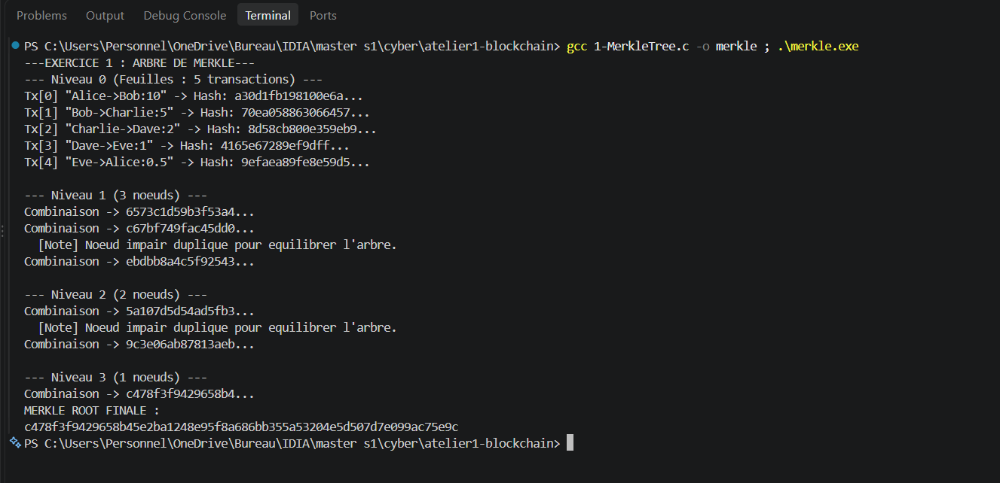
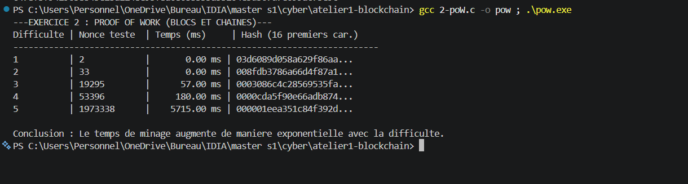
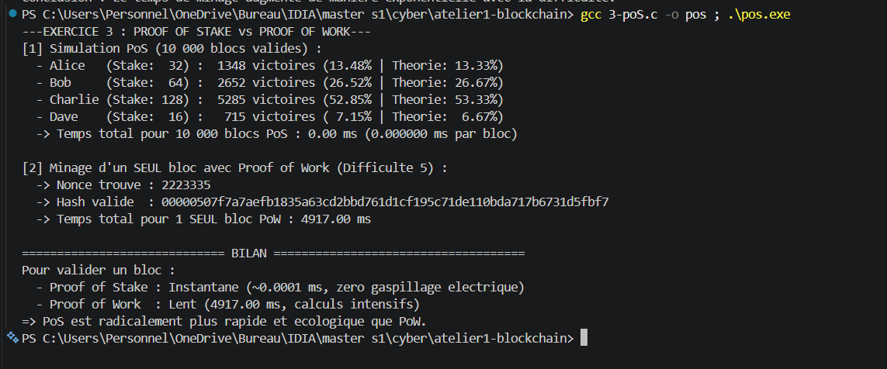
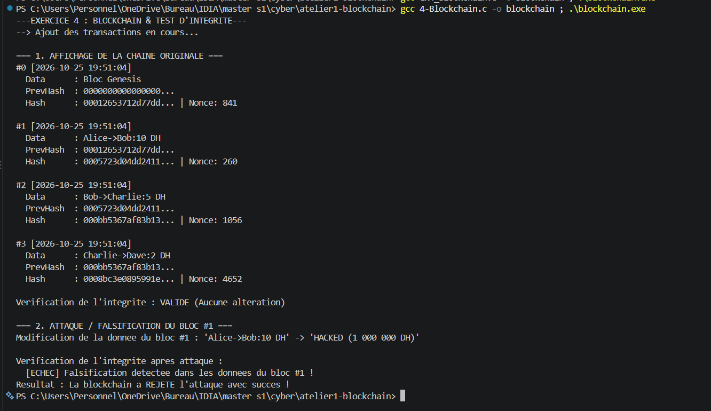

# CyberSecurite

<summary>TD1: Blockchain</summary>

## EXERCICE 1: '1-MerkleTree.c'

#### RUN:

```bash
gcc 1-MerkleTree.c -o merkle ; .\merkle.exe
```



## EXERCICE 2: '2-poW.c'

#### RUN:

```bash
gcc 2-poW.c -o pow ; .\pow.exe
```



## EXERCICE 3: '3-poS.c'

#### RUN:

```bash
gcc 3-poS.c -o pos ; .\pos.exe
```



## EXERCICE 4: '4-Blockchain.c'

#### RUN:

```bash
gcc 4-Blockchain.c -o blockchain ; .\blockchain.exe
```



